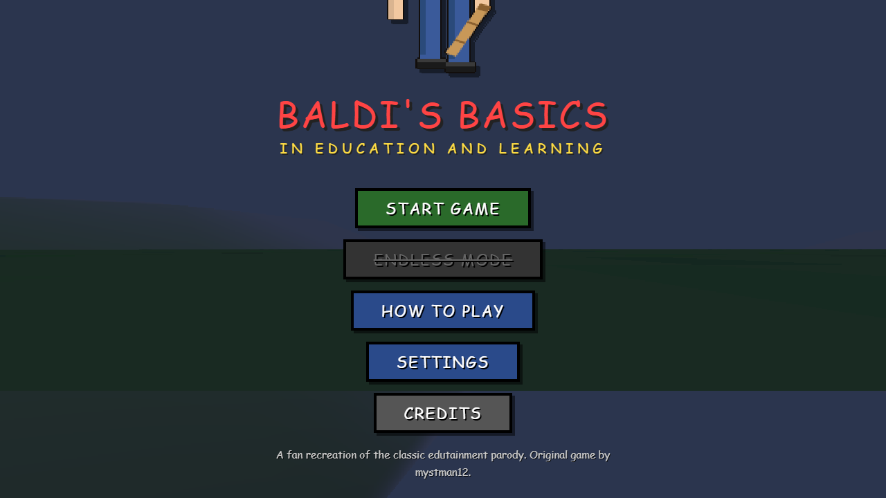
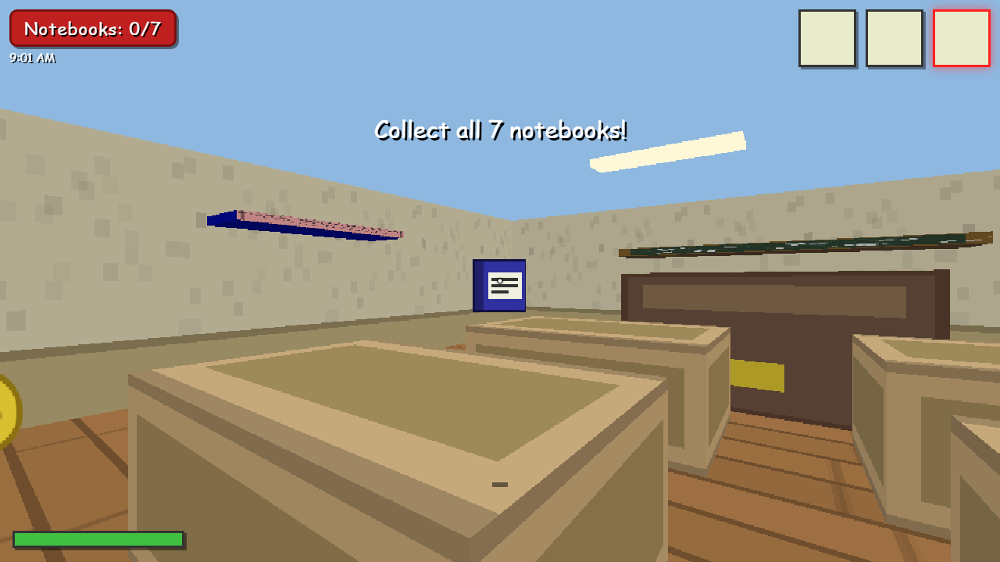
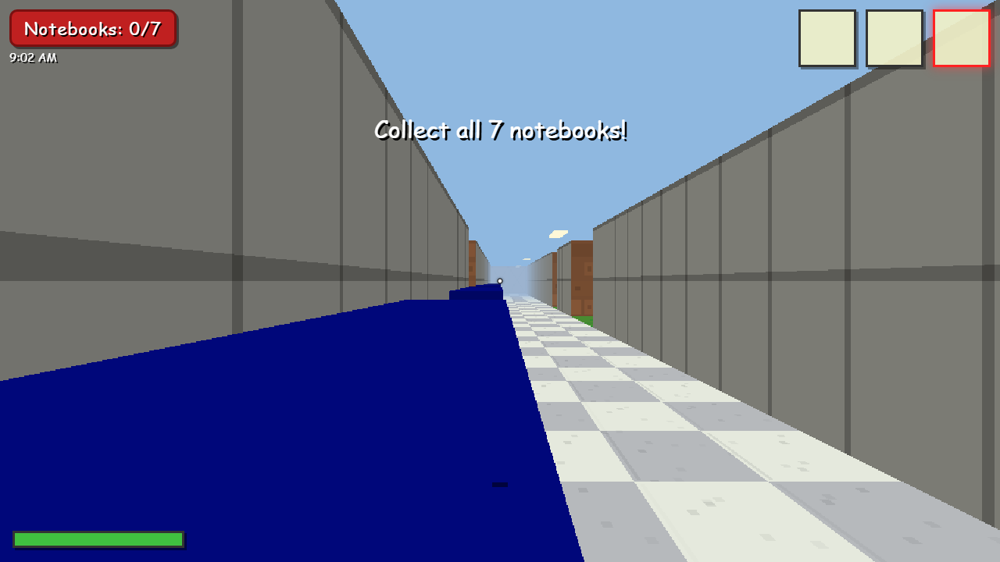
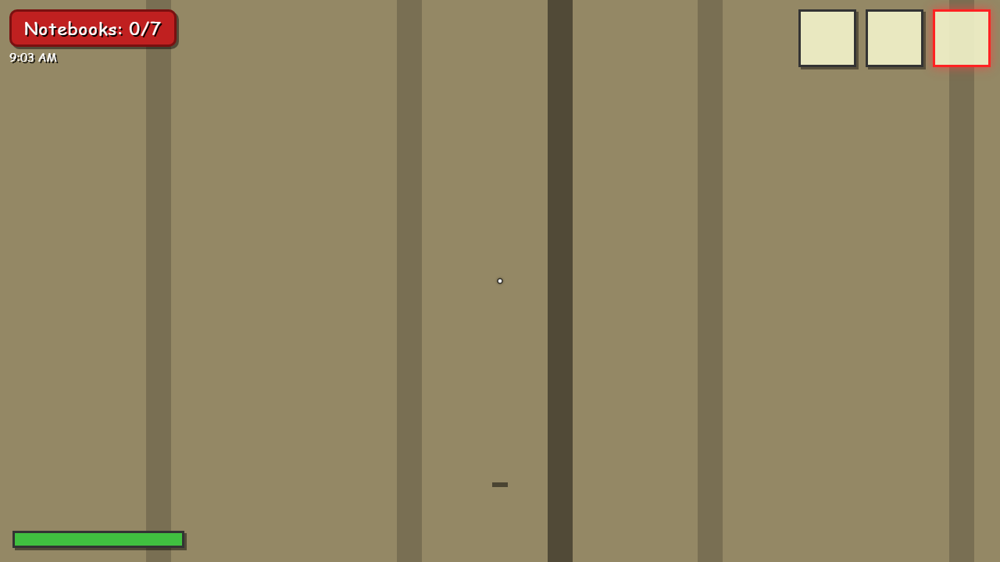
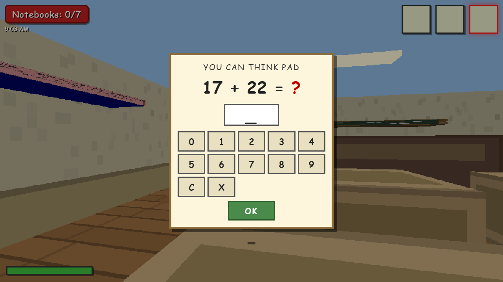

# Baldi's Basics in Education and Learning — Web Fan Recreation

A faithful, fan-made web recreation of the classic **Baldi's Basics in
Education and Learning (v1.4.x era)** by mystman12. Built with **Three.js**
(vendored locally) and **zero build steps** — open `index.html` and play.

> ⚠️ **Disclaimer**: This is an UNOFFICIAL fan tribute. "Baldi's Basics in
> Education and Learning" is a trademark/copyright of its creator
> **mystman12 (Micah McGonigal)**. This project is not affiliated with or
> endorsed by the original author. All graphics, audio and code in this
> repository are original recreations. Released under the MIT License.

## Play it

Just open **`index.html`** in Chrome / Edge / Firefox. No server, no npm,
no internet needed after download.

## Screenshots

| | |
|---|---|
|  |  |
|  |  |
|  | |

## Controls

| Input | Action |
|---|---|
| `WASD` / Arrows | Move |
| `Mouse` | Look around |
| `Click` | Interact (doors, notebooks, items, exits) |
| `SPACE` | Jump rope (Playtime's minigame) |
| `ESC` | Pause |
| `ALT` (hold) | Glance behind |
| `SHIFT` (hold) | Sprint (drains the stamina bar; recovers when you stop) |
| `1` / `2` / `3` or mouse wheel | Select item |
| `E` | Use the selected item |
| `Q` / right-click | Drop the selected item |
| `0-9` + `Enter` | Answer pads with your keyboard |

The center cursor shows a **white dot** normally and turns into a **hand**
when you can interact with something.

Languages: **English / 中文 / 日本語** (auto-detected, switchable in Settings).

## Goal & endings

- Collect all **7 notebooks** hidden around the school and answer 3 math
  problems in each one (be careful — notebooks 2 & 4 end with a garbled,
  unsolvable problem).
- After the 7th notebook the screen turns **blood-red** with a heartbeat and
  **Baldi goes SUPER FAST**. Grab the **Principal's Keys** (faculty room or
  library — all 4 exits are locked now), unlock one of them, and escape.
- **Hidden ending**: answer **all 21 problems wrong** for a special surprise.

## Seed mode

Type any **seed** on the main menu (or hit RANDOM SEED) to generate a
**brand new school** — procedurally built from the seed, fully playable and
reproducible: the same seed always builds the same school. Leave the seed
blank for the classic fixed map (also accepts `?seed=NAME` in the URL).

- Same layout bands as the classic school, but rooms, doors, corridors and
  spawns are all re-rolled every seed.
- Every school hides a **secret trophy room** in the playground sand. A
  strange poster near the sand hints at it... explore the wall behind it.

## Characters

- **Baldi** — your teacher. Wrong answers make him permanently angrier and
  faster. He slaps his ruler (louder as he closes in), and once enraged he
  *hears doors* — slam one nearby and he comes running.
- **Principal of the Thing** — enforces the rules: no running in the halls,
  no entering the faculty room. He drags you to **his office** for detention
  (15 → 99 seconds).
- **Playtime** — jump-rope minigame (5 jumps on rhythm); miss a full rope
  cycle and she steals an item. Cut her rope with scissors.
- **It's a Bully** — blocks the hallways and steals a random item.
- **Gotta Sweep** — a broom that sweeps the halls at speed; wear the
  Big Ol' Boots to resist.
- **1st Prize** — a robot that charges you on sight (pathfinding, no corner
  grinding); Safety Scissors short-circuit it for 15 seconds.
- **Arts and Crafters** — a shy sock puppet; with 7 notebooks he hunts you
  and touching him teleports you back to the entrance.
- **Mrs. Pomp** — catches you and drags you to her classroom for a
  subtraction lesson.

## Items

Quarter · BSoda (free sprint) · Zesty Bar · Principal's Keys · WD-NoSquee
(door wedge) · Safety Scissors · Alarm Clock (auto-stuns Baldi for 30s) ·
Dirty Chalk Eraser (smoke cloud blocks Baldi's sight & slows him) ·
Big Ol' Boots (sweep-proof).

## HUD (original layout)

- **Top-left**: notebook counter (0/7) + in-game clock
- **Top-right**: 3-slot item bar; the selected item's name shows below
- **Bottom-left**: stamina bar (green over red) — shift-sprinting drains it

## Tech notes

- Everything is **procedurally generated**: textures & pixel-art character
  sprites (canvas), sound effects & music (Web Audio API). Character voices
  use the browser's speech synthesis (toggle in Settings).
- Character sprites match the original proportions (tall lanky Baldi, stocky
  Bully...) with 4-frame walk cycles.
- Renders at 960×540 with nearest-neighbour upscaling for a crisp retro look.
- Enemy AI: A* pathfinding with path smoothing, line-of-sight checks
  (no catching through closed doors), bounded wandering, stuck recovery,
  and a route-graph patrol for Gotta Sweep (no teleporting).
- `tests/` — Node map-structure validation:
  `node tests/map-check.js` (classic map) and `node tests/seed-map-test.js`
  (procedural seed maps)

## Project structure

```
baldis-basics/
├── index.html              # single-page entry (no build step)
├── css/style.css
├── vendor/three.min.js     # Three.js r128 (local, offline-friendly)
├── js/
│   ├── main.js             # boot, loop, input, event wiring
│   ├── renderer.js         # low-res 3D world + sprites
│   ├── map.js              # school floor plan, furniture, pathfinding
│   ├── mapgen.js           # procedural seed -> school grid generator
│   ├── systems/seed.js     # seeded RNG (xmur3 + mulberry32)
│   ├── assets/             # procedural textures / sprites / audio
│   ├── entities/           # player, Baldi, Principal, Playtime, Bully,
│   │                       #   Gotta Sweep, 1st Prize, Arts & Crafters,
│   │                       #   Mrs. Pomp, notebooks, items, vending, exits
│   └── systems/            # ai, doors, math, ui, howto, i18n, saves, events
└── tests/map-check.js
└── tests/seed-map-test.js
```

## Credits

- **Original game**: mystman12 (Micah McGonigal) — *Baldi's Basics in
  Education and Learning*
- This recreation: all code, pixel art, textures and audio are original
  creations by the fan contributors of this repository.
- Third-party: [Three.js](https://threejs.org) (r128, MIT license).

## License

[MIT](LICENSE) — use it, learn from it, remix it. Please keep the
fan-recreation disclaimer in mind.
